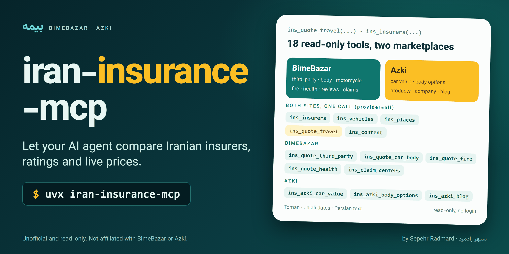

<!-- mcp-name: io.github.sepehr071/iran-insurance-mcp -->

<div align="center">



# iran-insurance-mcp: Iran insurance (بیمه) MCP server for AI agents, BimeBazar + Azki

**iran-insurance-mcp is an unofficial, read-only MCP server that lets an AI agent compare Iranian insurance on two marketplaces, BimeBazar (بیمه‌بازار, bimebazar.com) and Azki (ازکی, azki.com), side by side.**<br>
Its 18 tools rank insurers by rating, compare live travel insurance prices from both sites in one call, and quote third-party car insurance (بیمه شخص ثالث), car body (بیمه بدنه), motorcycle, fire (آتش‌سوزی) and supplementary health (بیمه تکمیلی) on BimeBazar.<br>
No API key or account is needed; it works in Claude, Cursor, Copilot and any other MCP client.

[](https://pypi.org/project/iran-insurance-mcp/)
[](https://pypi.org/project/iran-insurance-mcp/)
[](https://github.com/sepehr071/iran-insurance-mcp/actions/workflows/ci.yml)
[](https://registry.modelcontextprotocol.io/?q=iran-insurance-mcp)
[](https://github.com/sepehr071/iran-insurance-mcp/blob/main/LICENSE)

[](https://vscode.dev/redirect/mcp/install?name=iran-insurance&config=%7B%22command%22%3A%22uvx%22%2C%22args%22%3A%5B%22iran-insurance-mcp%22%5D%7D)
[](https://cursor.com/install-mcp?name=iran-insurance&config=eyJjb21tYW5kIjoidXZ4IiwiYXJncyI6WyJpcmFuLWluc3VyYW5jZS1tY3AiXX0%3D)

[For AI agents](#for-ai-agents) · [Quick start](#quick-start) · [What it can do](#what-it-can-do) · [Tools](#tools) · [Limits](#limits) · [FAQ](#faq) · [فارسی](#فارسی)

</div>

---

## For AI agents

- **What:** unofficial MCP server (model context protocol) for bimebazar.com and azki.com, merged: insurers with ratings, vehicle and place lookups, travel insurance prices from both, guides and FAQ, plus each site's own tools.
- **Install:** `uvx iran-insurance-mcp` or `claude mcp add iran-insurance -- uvx iran-insurance-mcp`. Transport: stdio. Needs [uv](https://docs.astral.sh/uv/getting-started/installation/) (Python 3.10+).
- **Auth:** none. Optional `IRAN_INSURANCE_MCP_PROXY` (HTTP proxy URL, or a comma-separated list) applies to both sites; system proxy settings are ignored.
- **Access:** read-only. It cannot log in, buy, pay or file a claim, and never asks for a national ID, phone number or plate.
- **Tools:** 18, all prefixed `ins_`. Five take `provider` (`all` default, `bimebazar`, `azki`) and answer with one block per provider; if one site fails its block holds an `error` and the other still answers.
- **Use when:** the user asks which insurer is rated best, what third-party, body, motorcycle, fire or supplementary health insurance costs, what travel insurance costs on each site, where to file a claim, or how an insurance line works.
- **Do not use when:** the user needs a purchase, a life insurance price, or a plate/national-ID inquiry.
- **Output:** compact JSON. Prices are Toman unless a field says otherwise, years Jalali, text Persian.
- **Rate limit:** BimeBazar allows about 25-30 calls per minute per IP. A travel comparison uses about five calls; do not loop.
- **Machine-readable:** [`server.json`](https://github.com/sepehr071/iran-insurance-mcp/blob/main/server.json) and the [iran-mcp catalog](https://github.com/sepehr071/iran-mcp).

Last verified: 2026-11-01.

## What it can do

- **Compare insurers** (شرکت‌های بیمه) with each site's ratings: BimeBazar market share, satisfaction and solvency; Azki service stats and customer rating
- **Compare travel insurance** (بیمه مسافرتی) prices from both sites for the same trip in one call, by country name and stay length
- **Quote third-party car insurance** (بیمه شخص ثالث), cheapest first, with or without a previous policy (BimeBazar)
- **Quote car body** (بیمه بدنه), **motorcycle**, **home fire** (بیمه آتش‌سوزی) and **supplementary health** (بیمه تکمیلی) for one person, several people or a family (BimeBazar)
- **Estimate a car's market value** and list optional body covers and no-claim discount steps (Azki)
- **Find vehicles and places**: brand and model ids from both catalogs, provinces and cities with each site's ids
- **Read customer reviews** of insurers, find damage-claim branches by insurer and place, look up insurance and car-card terms
- **Read guides and FAQs** of each insurance line, plus Azki's company pages, products and blog

Example prompts:

- "Compare Iranian car insurance prices from an AI agent: which insurer is cheapest for third-party insurance on a Peugeot 206?"
- "Compare travel insurance for Turkey for 7 days on BimeBazar and Azki."
- "Which Iranian insurance company has the best customer satisfaction and claim payment?"
- "Where can I file a car damage claim with this insurer in Tehran?"
- <span dir="rtl">ارزان‌ترین بیمه شخص ثالث برای پژو ۲۰۶ کدام شرکت است؟</span>
- <span dir="rtl">قیمت بیمه مسافرتی ترکیه برای ۷ روز در بیمه‌بازار و ازکی را مقایسه کن.</span>
- <span dir="rtl">کدام شرکت بیمه بیشترین رضایت مشتری را دارد؟</span>

## Quick start

You need [uv](https://docs.astral.sh/uv/getting-started/installation/). No API key or account.

<details open>
<summary><b>Claude Code</b></summary>

```bash
claude mcp add iran-insurance -- uvx iran-insurance-mcp
```
</details>

<details>
<summary><b>Claude Desktop</b></summary>

Settings → Developer → Edit Config, then add:

```json
{
  "mcpServers": {
    "iran-insurance": { "command": "uvx", "args": ["iran-insurance-mcp"] }
  }
}
```
</details>

<details>
<summary><b>Cursor</b></summary>

Click **Install in Cursor** above, or add the Claude Desktop block to `~/.cursor/mcp.json` (or `.cursor/mcp.json` in a project).
</details>

<details>
<summary><b>VS Code (Copilot agent mode)</b></summary>

Click **Install in VS Code** above, or add to `.vscode/mcp.json`:

```json
{
  "servers": {
    "iran-insurance": { "type": "stdio", "command": "uvx", "args": ["iran-insurance-mcp"] }
  }
}
```
</details>

<details>
<summary><b>Anything else</b></summary>

It is a standard stdio MCP server: run `uvx iran-insurance-mcp`, or `pip install iran-insurance-mcp` and run `iran-insurance-mcp`.
</details>

## Tools

Merged (both sites, `provider` argument):

| Tool | What it does | Call next |
|---|---|---|
| `ins_insurers` | Insurers with each site's ratings: BimeBazar market share, satisfaction, solvency; Azki service stats and customer rating (`azki_kind` third or body). | `ins_insurer_reviews`, `ins_claim_centers`, `ins_azki_body_options`, quote tools (`previous_company`) |
| `ins_vehicles` | Brand and model ids from both vehicle catalogs (car, motorcycle, pickup, van, truck). | `ins_quote_third_party`, `ins_quote_car_body` (BimeBazar values), `ins_azki_car_value` (Azki id) |
| `ins_places` | Provinces and cities with each site's ids. | `ins_quote_fire`, `ins_claim_centers` |
| `ins_quote_travel` | Live travel prices from both sites for the same trip. Takes country names and a duration bucket; resolves each site's ids itself. | (end of flow) |
| `ins_content` | Short explanation, guide steps and FAQ of one insurance line (third_party, car_body, motorcycle, travel, fire, life, health, sanhab). | `ins_quote_*` |

BimeBazar only:

| Tool | What it does |
|---|---|
| `ins_quote_third_party` | Live third-party car prices from every insurer, cheapest first (with or without a previous policy). |
| `ins_quote_motorcycle` | Live motorcycle third-party prices. |
| `ins_quote_car_body` | Live car body insurance prices. |
| `ins_quote_fire` | Live home fire insurance prices. |
| `ins_quote_health` | Live supplementary health prices for one person, several people or a family. |
| `ins_insurer_reviews` | Customer reviews of insurers (four 1-5 ratings and text, no names). |
| `ins_claim_centers` | Damage-claim branches by insurer, place and claim type. |
| `ins_glossary` | Short explanations of insurance and car-card terms (VIN, chassis number ...). |

Azki only:

| Tool | What it does |
|---|---|
| `ins_azki_car_value` | Market value estimate (average, low, high) of a car model and year. |
| `ins_azki_body_options` | Optional covers and no-claim discount steps of one company for car body insurance. |
| `ins_azki_products` | Products of Azki's generic engine (life, elevator, fire and more). |
| `ins_azki_company` | List companies, read one company's profile and FAQ, or its page for one insurance type. |
| `ins_azki_blog` | Azki insurance blog posts, newest first, with search and categories. |

Travel is the one quote both sites price anonymously, so it is merged. The other quote tools stay BimeBazar only: Azki shows car, health, life and fire prices only after a phone number. Inputs also differ (BimeBazar asks brand/model values and previous-policy details; Azki's flow has no public price call), so there is nothing to merge.

Migrating from the single-site servers: `bb_insurers`/`az_companies` -> `ins_insurers`; `bb_vehicles`/`az_vehicles` -> `ins_vehicles`; `bb_locations`/`az_zones` -> `ins_places`; `bb_quote_travel`/`az_travel_quote` (+ both country lists, `az_lookup` travel lists) -> `ins_quote_travel`; `bb_faq`/`az_landing` -> `ins_content`; `bb_quote_*` -> `ins_quote_*`; `bb_insurer_reviews`, `bb_claim_centers`, `bb_glossary` -> `ins_*`; `az_car_value`, `az_body_options`, `az_products`, `az_company`, `az_blog` -> `ins_azki_*`. `az_lookup` is not exposed (the travel lists it served are used internally).

## Limits

- Azki does not show car (third-party, body, motorcycle), health, life or fire premiums without a phone number, so only BimeBazar prices those. Life insurance offers are empty on BimeBazar too (it also asks for a phone number first).
- The Sanhab plate/national-ID inquiry is not exposed; `ins_content('sanhab')` explains it.
- BimeBazar rate-limits one IP to about 25-30 calls per minute (HTTP 429); the client backs off and retries, and a travel comparison uses about five calls.
- Azki travel prices come as the API sends them; their currency is not confirmed (they sit on the same scale as BimeBazar's Toman prices). `medical_cover` is a foreign-currency amount, not Toman.
- Quotes are estimates for comparison; the price to pay is shown only when buying on the site. Unofficial: not affiliated with either site. Site and blog text is third-party content.
- Both sites sit behind Iranian CDNs; from abroad set `IRAN_INSURANCE_MCP_PROXY` to a proxy that works, or run from Iran. The server ignores system proxy variables on purpose.

## FAQ

<details>
<summary><b>How can an AI agent compare Iranian car insurance prices?</b></summary>

Add `iran-insurance-mcp`, then ask in plain language. The agent finds the vehicle with `ins_vehicles`, then calls `ins_quote_third_party` (or `ins_quote_car_body`), which returns every insurer's live BimeBazar price, cheapest first. Azki's car prices are not public without a phone number, so they are not included.
</details>

<details>
<summary><b>What is the difference between BimeBazar and Azki?</b></summary>

Both are Iranian online insurance marketplaces (بیمه‌بازار and ازکی) that list the same insurers. BimeBazar shows live prices for third-party, body, motorcycle, fire and supplementary health without login; Azki shows them only after a phone number, but shows travel prices, car value estimates and company ratings. This server merges what each shows publicly.
</details>

<details>
<summary><b>How do I compare travel insurance (بیمه مسافرتی) prices?</b></summary>

Call `ins_quote_travel` with the country names and the stay length. It resolves each site's ids itself and returns both sites' offers for the same trip, so one call replaces about five.
</details>

<details>
<summary><b>Which Iranian insurance company is the best?</b></summary>

`ins_insurers` returns BimeBazar's market share, satisfaction and solvency and Azki's service stats and customer rating, and `ins_insurer_reviews` returns customer reviews. The server reports the numbers; it does not pick a winner for you.
</details>

<details>
<summary><b>Can it buy insurance or file a claim?</b></summary>

No. It is read-only, cannot log in or pay, and never asks for a national ID, phone number or plate. `ins_claim_centers` only lists where to file a claim.
</details>

<details>
<summary><b>Does it work outside Iran?</b></summary>

Both sites sit behind Iranian CDNs. From abroad set `IRAN_INSURANCE_MCP_PROXY` to an HTTP proxy that reaches them, or run it from Iran.
</details>

<details>
<summary><b>Is the price final?</b></summary>

No. Quotes are estimates for comparison; the price to pay is shown only when buying on the site.
</details>

<details>
<summary><b>How do I debug what the agent sees?</b></summary>

```bash
npx @modelcontextprotocol/inspector uvx iran-insurance-mcp
```
</details>

## Configuration

| Variable | Default | Meaning |
|---|---|---|
| `IRAN_INSURANCE_MCP_PROXY` | unset | Optional HTTP proxy URL for BimeBazar and Azki requests; system proxy settings are ignored. A comma-separated list is used one at a time: the next proxy takes over when one is blocked or cannot connect |

<a id="فارسی"></a>

## فارسی: سرور MCP بیمه برای دستیار هوش مصنوعی

<div dir="rtl">

پروژه **iran-insurance-mcp** یک سرور MCP غیررسمی و فقط‌خواندنی برای مقایسه بیمه در دو بازارگاه ایرانی است: بیمه‌بازار (bimebazar.com) و ازکی (azki.com). با آن، دستیار هوش مصنوعی شما (Claude، Cursor، Copilot و ...) شرکت‌های بیمه و امتیاز آن‌ها را مقایسه می‌کند، قیمت بیمه مسافرتی را از هر دو سایت یک‌جا می‌گیرد و قیمت بیمه شخص ثالث، بدنه، موتورسیکلت، آتش‌سوزی و تکمیلی را از بیمه‌بازار می‌آورد.

**نکته‌ها**

- فقط می‌خواند؛ نمی‌خرد، پرداخت نمی‌کند و کد ملی، شماره تلفن یا پلاک نمی‌خواهد.
- ازکی قیمت بیمه خودرو، درمان و آتش‌سوزی را بدون شماره تلفن نشان نمی‌دهد، پس این قیمت‌ها فقط از بیمه‌بازار می‌آید.
- قیمت‌ها تومان و تاریخ‌ها شمسی است. قیمت نهایی را فقط هنگام خرید در سایت می‌بینید.
- بیمه‌بازار حدود ۲۵ تا ۳۰ درخواست در دقیقه را برای هر IP می‌پذیرد.
- کلید API لازم نیست و سرور روی سیستم خود شما اجرا می‌شود. از خارج از ایران ممکن است لازم باشد `IRAN_INSURANCE_MCP_PROXY` را تنظیم کنید.

**نصب** (اول [uv](https://docs.astral.sh/uv/getting-started/installation/) را نصب کنید). در Claude Code:

</div>

```bash
claude mcp add iran-insurance -- uvx iran-insurance-mcp
```

<div dir="rtl">

در Claude Desktop، Cursor و بقیه برنامه‌ها همان تنظیم بخش [Quick start](#quick-start) را بگذارید.

</div>

## Development

```bash
git clone https://github.com/sepehr071/iran-insurance-mcp && cd iran-insurance-mcp
uv sync
uv run ruff check . && uv run ruff format --check .
uv run python -m pytest -q          # offline unit tests on recorded fixtures
uv run python -m pytest -m live -q  # live calls to BimeBazar and Azki (few, mind the rate limit)
```

Issues and PRs are welcome. Releases: bump the version in `pyproject.toml` and `server.json`, then push a `v*` tag; GitHub Actions publishes to PyPI.

## Related servers

- [codal-mcp](https://github.com/sepehr071/codal-mcp) for Codal disclosures and financial statements of Iranian listed companies
- [tsetmc-mcp](https://github.com/sepehr071/tsetmc-mcp) for Tehran Stock Exchange prices, order book and indices
- [iran-gold-mcp](https://github.com/sepehr071/iran-gold-mcp) for live 18k gold prices on Iranian platforms
- [iran-mcp](https://github.com/sepehr071/iran-mcp): catalog of all Iranian-service MCP servers

## Disclaimer

Unofficial and not affiliated with or endorsed by BimeBazar or Azki. It is read-only and uses the public API and pages of those sites, which can change without notice. Data is informational and quotes are estimates; nothing here is insurance or financial advice.

## Author

<a href="https://www.linkedin.com/in/sepehr-radmard"></a>

Built and maintained by **Sepehr Radmard** (سپهر رادمرد). Connect on [LinkedIn](https://www.linkedin.com/in/sepehr-radmard) or follow [@sepehr071 on GitHub](https://github.com/sepehr071) for more MCP servers for Iranian websites, all listed in [iran-mcp](https://github.com/sepehr071/iran-mcp). If this saves you time, a star on the repo helps other people find it.

## License

[MIT](https://github.com/sepehr071/iran-insurance-mcp/blob/main/LICENSE)
